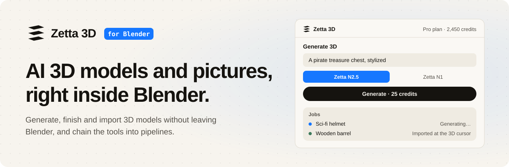
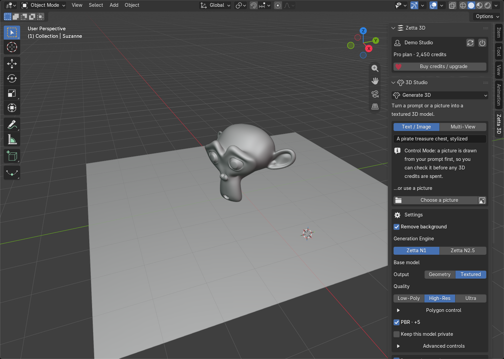
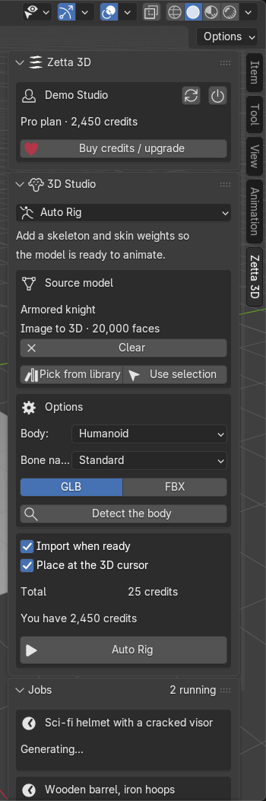
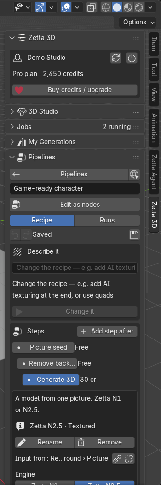
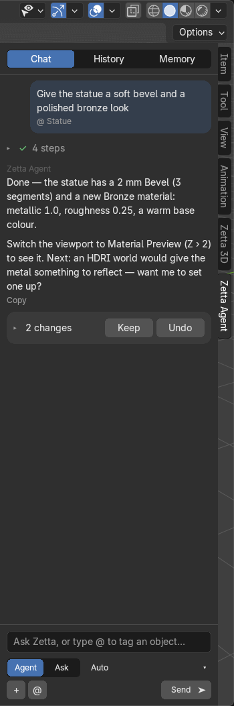
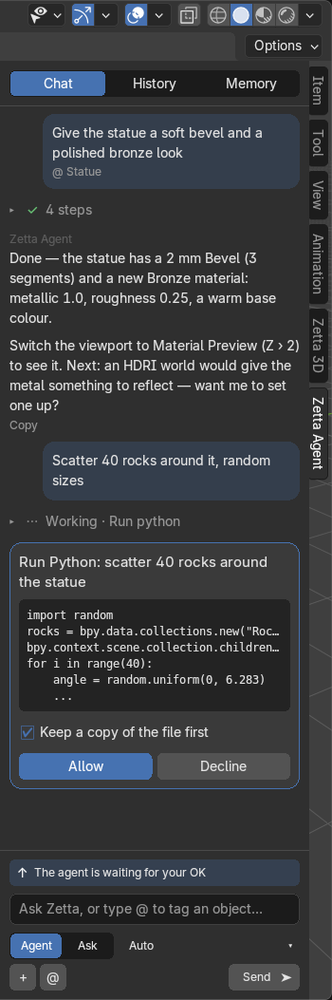
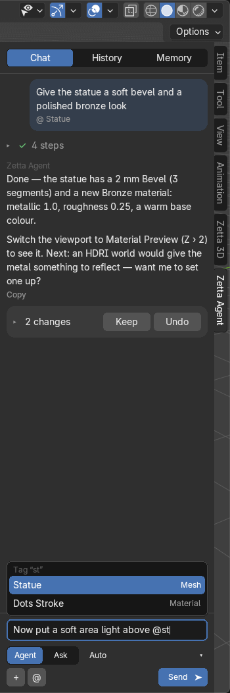

<p align="center">
  <picture>
    <source media="(prefers-color-scheme: dark)" srcset="docs/images/banner-dark.svg">
    
  </picture>
</p>

<p align="center">
  <a href="#install"></a>
  <a href="#install"></a>
  <a href="CHANGELOG.md"></a>
  <a href="#license"></a>
</p>

<p align="center">
  <a href="#install"><b>Install</b></a> ·
  <a href="#sign-in"><b>Sign in</b></a> ·
  <a href="#3d-studio"><b>3D Studio</b></a> ·
  <a href="#my-generations"><b>My Generations</b></a> ·
  <a href="#3d-pipelines"><b>Pipelines</b></a> ·
  <a href="#the-zetta-agent"><b>Agent</b></a> ·
  <a href="#settings"><b>Settings</b></a> ·
  <a href="https://zetta3d.ai"><b>zetta3d.ai</b></a>
</p>

<br>

**Zetta 3D for Blender** puts your [Zetta 3D](https://zetta3d.ai) account inside Blender. Use it to:

- **make 3D models** from text, a picture or several views, and finish them: retopology, segmentation, UVs,
  texturing and rigging;
- **make pictures** — textures, references, concept art — and turn any of them into a model;
- **bring them into your scene** in one click: downloaded, imported into its own collection, and standing on the
  ground at the 3D cursor;
- **chain the tools into pipelines** that run over many pictures or models at once;
- **work with the Zetta Agent**, an assistant that models, shades, lights, animates and scripts in your open file
  with Blender's own tools, looks at the result to check it, makes the art it needs, and teaches you Blender as it
  goes — on your Zetta account or on [your own API key](#your-own-api-keys).

Everything you make is also in your library on zetta3d.ai, and everything you made there (or in Unity) shows up in
Blender.

## Install

**You need:** Blender **4.2 LTS** or newer and a [Zetta 3D](https://zetta3d.ai) account (free to start).

1. Download `zetta3d-<version>.zip` from the
   [latest release](https://github.com/ig-shadow-walker/Zetta3D-BlenderPlugin/releases/latest). Don't unzip it.
2. In Blender, open **Edit › Preferences › Get Extensions**, click **⌄** (top right) › **Install from Disk…**, and
   pick the zip.
3. Make sure **Preferences › System › Network › Allow Online Access** is on — the add-on talks to zetta3d.ai.

Then press **N** in the 3D View and open the **Zetta 3D** tab.

<details>
<summary><b>Update and remove</b></summary>

<br>

**Update.** The add-on checks for a newer release when Blender starts and every 6 hours while it stays open. When
one is out, a line at the top of the Zetta 3D tab says so, with **What's new** and **Update**: it downloads the
release and installs it over this copy — restart Blender to finish. You can also check any time from
**Preferences › Add-ons › Zetta 3D › Check for updates**. The [changelog](CHANGELOG.md) lists what each version
adds.

**Remove.** **Preferences › Add-ons › Zetta 3D › Uninstall**. Models you imported stay in your files.

</details>

<details>
<summary><b>Install problems</b></summary>

<br>

- **"Online access is turned off in Blender"** in the Zetta 3D tab — turn on **Preferences › System › Network ›
  Allow Online Access** (the tab has a button that opens it).
- **No Zetta 3D tab** — press **N** in the 3D View to show the sidebar, and check that **Zetta 3D** is ticked under
  **Preferences › Add-ons**.
- **"Install from Disk" is missing** — you are on Blender 4.1 or older. The add-on needs 4.2 LTS or newer.

</details>

## Sign in

In the Zetta 3D tab, click **Sign in with your browser**, sign in on zetta3d.ai and click **Connect Blender**. That's
it — Blender receives its own session and never sees your password. The session is kept in the add-on's private
folder on your computer, never in a .blend file, so it never travels with your scenes.

Everything lives in the **Zetta 3D** tab of the 3D View's sidebar, as panels: **3D Studio**, **Jobs**, **My
Generations** and **Pipelines**, under your account and credits.

## 3D Studio

Every tool from the web Studio, in Blender's sidebar. Pick one from the menu at the top of the panel.

<p align="center">
  
</p>

| Tool | What it does |
|---|---|
| **Generate 3D** | Text, a picture or several views → a 3D model, on Zetta N1 or N2.5, with every option the web Studio has |
| **Smart 3D** | Clean, game-ready topology from the start, on Zetta Np1 or Np1.5 |
| **Segment** | Split a model into named parts (or let Smart Segment decide them) — each imports as its own object |
| **Retopology** | Rebuild a mesh at a polygon budget, as triangles or quads |
| **Smart UV** | Lay a model's UVs out again as a clean layout, keeping its textures, rig and animation |
| **Texture** | Re-texture a model from a description, a reference picture or pictures of each side, up to 8K |
| **Auto Rig** | Rig humanoids, animals and other creatures — Standard, Mixamo, Unity Humanoid, UE5, VRM or ActorCore bone names; GLB or FBX |
| **Image Studio** | Generate, edit and compose pictures; save them as Blender images or send them to Generate 3D |



- **Pictures** come from a file, or from any image already in your .blend (the image button next to each picker).
  In the Image Editor, **Image › Generate 3D from this image** does the same.
- **Control Mode** (on by default) draws a picture from your prompt first and stops, so you can check it — or
  **Redraw** or **AI edit** it — before any 3D credits are spent.
- **Multi-View**: drop the views you have; **Generate missing views** draws the rest from your reference.
- **The finishing tools** work on a **source model**: **Pick from library**, or select objects in the 3D View and
  press **Use selection**. A model imported from Zetta 3D is used directly; anything else is exported as GLB and
  uploaded to your library first, free. Right-click › **Zetta 3D › …** in the 3D View does the same.
- **Auto Rig › Detect the body** renders the model from four sides and tells you what kind of body it has.
- **Every panel shows the price** before you start, and your balance.

Finished models import into `//zetta3d/models/<id>-<name>/` next to your .blend (change it in
[Settings](#settings)) and, with **Place at the 3D cursor** on, stand on the ground at the cursor, in their own
collection under **Zetta 3D**.

### Jobs

The **Jobs** panel follows everything you started — queue position, progress, and the import when it lands. Jobs run
on the server: close Blender and they keep going, and the next time you open it they're picked up and imported.

<br clear="right">

## My Generations

Everything you've made on Zetta 3D — on the web, in Unity or in Blender — with thumbnails.

- **Import**, **Show** (select it in the scene) or **Place** another copy at the 3D cursor. **⋯** has **Import as
  child of the active object**, **Send to** a finishing tool, **Fork** a generation's settings back into Generate,
  **Rename**, **Delete**, and the UV layout picture of a Smart UV result.
- Search, filter by kind and status, page through, and select several to delete together.
- A pipeline run is one tile: open it to see its models in the order the run made them, with **Import all**,
  **Delete all** and **Open run**.
- **Images** shows your 2D library: save a picture into your images folder, use it for 3D, or edit it.
- **Upload selection to library** sends the selected objects to your library as a GLB, free.

Gaussian splats and worlds made on zetta3d.ai are listed too, but Blender can't import them here; they open on the
web.

## 3D Pipelines



Chain the Studio's tools into a reusable recipe — the same pipelines as on
[zetta3d.ai/pipelines](https://zetta3d.ai/pipelines).


- **Edit it as nodes.** **Edit as nodes** opens the pipeline in Blender's Node Editor (it's also in the editor
  type menu as **Zetta 3D Pipeline**). Each step is a node, wired left to right, with its ports coloured by what
  they carry: a picture, pictures of each side, a model. **Shift+A** adds a step, dragging between ports wires
  them, **X** deletes and **Shift+D** duplicates with the same settings. **Ctrl+Z** undoes the pipeline's last
  change. A wire that carries the wrong thing is refused with the reason. Each node shows what it's set to, what it
  costs and what still needs doing. The selected step's settings, **Describe it**, **New run…** and **Runs** are
  in the editor's sidebar (**N › Pipeline**). Open a run there and the canvas shows it, each step coloured by how
  far it got.
- **Describe it** — *"a game-ready character from a photo, rigged"* — and the recipe is built for you. With a
  recipe there, describe a change instead (*"add AI texturing at the end"*); **Undo** brings back what was there.
- **Or build it step by step** in the sidebar: **Add step after** the selected one (wired up for you), pick each step's **Input
  from**, and set it up below. Seeds, Remove background, AI edit, Draw views, Isolate parts, Generate 3D and Smart 3D
  (and their Multi-view versions), Retopology, Segmentation, AI texturing, Smart UV and Auto rig — every option the
  web has.
- The recipe **checks itself** as you build, shows its **price per run**, saves as you go, and has undo and redo.
- **New run…** on up to 20 pictures, models or sets of pictures at once — **Manual** (it waits for you before each
  step) or **Auto** — with **Import results when done**.
- **Runs** shows each run's steps and results: run waiting steps, choose the parts Isolate parts found, retry a
  failed step (with new settings if you like), pause, resume or cancel, and import any model a step made. Runs keep
  going on the server even if Blender is closed.

<br clear="right">

## The Zetta Agent



The **Zetta Agent** tab in the 3D View's sidebar is an assistant that works in your open .blend. Tell it what you
want in plain words — *"give the statue a soft bevel and a polished bronze look"*, *"light this for a product
shot"*, *"why is my render black?"*, *"how do I UV unwrap this?"* — and it does the work with Blender's own tools,
one visible step at a time, then looks at the result.

**Chat**, **History** and **Memory** stay at the top of the tab and the message box at the bottom, while the
conversation scrolls between them. **Enter** sends and **Shift+Enter** starts a new line. Under the box you choose
**Agent** or **Ask**, and **▾** sets the model, how hard it thinks, and whether it asks first.

**What it understands.** With every message it gets a picture of where you are: your Blender version, the file,
the mode, what you have selected, recent Python errors and an outline of the scene. It reads further wherever the
task needs it — any object's properties, modifier stacks, node trees, texts — and it checks Blender's own Python
API for your version before it writes a property it isn't sure of.

**What it can do:**

| Area | What it does |
|---|---|
| **Objects and scenes** | Adds, moves, renames, parents and organises objects and collections; selects; switches modes |
| **Any property** | Sets any property by its data path — modifiers, lights, cameras, render settings — checked against what it takes |
| **Modelling** | Modifiers and constraints; applies, joins, separates, smooths, cleans up meshes, unwraps UVs |
| **Shading** | Makes Principled materials with textures wired the right way; edits shader, world, compositor and Geometry Nodes trees |
| **Animation** | Keys any property over time |
| **Looking** | Captures the viewport (as you see it, or from around an object) and renders previews to check its work |
| **Files** | Imports and exports models, writes scripts and texts, appends and links from other .blend files, saves |
| **Python** | Runs a script for what no other tool does — you see the code first |
| **Zetta 3D** | Generates and finishes 3D models, makes and edits pictures, builds and runs pipelines — with a card showing the price, where **Build in Blender** has the agent model it with Blender's own tools instead, for no credits |
| **Showing you** | Frames objects, switches views and shading, and opens the right panel when you ask where something is |

**You stay in charge:**

- **Every change is undoable.** Each step is named on Blender's undo stack ("Zetta Agent: Added Bevel to Statue"),
  and the line under a reply says what the message changed, with **Keep** and **Undo** (open it to see the list).
- **Ask first** (the default) shows a card before anything risky — deleting, running Python, opening another file
  — and every credit-spending tool always shows its price first. **Full autonomy** lets it carry a request through
  without stopping, except that generating a 3D model always shows its card, so you decide before credits are
  spent on it.
- **A copy before risky steps.** Before the agent runs Python, deletes, applies or imports, it can keep a copy of
  the file — you tick or untick it on the card, and Preferences decides when there is no card. **Restore the file
  as it was** brings it back, even when undo can't.
- **Python is guarded.** Code the agent writes is shown to you first, and the add-on refuses code that would run
  programs, go online, delete files, load native code, change your preferences or add-ons, or build code from
  strings — whatever the autonomy. Blender has no sandbox, so this is a guard, not a cage: read the code on the
  card before you allow it.
- **Stop** ends whatever it's doing, straight away.



**Point it at things.** Type **@** in the message box and a list of the file's objects, materials, collections,
node groups, images and texts opens as you type. Pick one with the arrow keys and **Enter**, or click it (the
**@** button under the box starts the same list). Right-click › **Add to Zetta Agent** in the 3D View or the
Outliner, or **⇧⌘M / Ctrl+Shift+M**, tags what's selected. **+** under the box attaches a **picture of the
viewport**, a picture file or a PDF, a text file (it's read in), or any other file (copied next to your .blend for
the agent to import). For a long message, **Write a long message…** opens it in a Text Editor window with **Send to
Zetta Agent** in its header.



**Ask mode** explains and shows — it reads your file and opens the right panels, but changes nothing. Switch to
**Agent** to have it done.

**Memory.** The agent keeps a brief for each .blend file (what it's for, its structure, key decisions) and notes
about your preferences, and uses them in every conversation. **Memory** shows and deletes them; **History** has
your past conversations in this file.

<br clear="right">

## Settings

**Preferences › Add-ons › Zetta 3D**:

| Setting | What it does |
|---|---|
| **Account** | Who you're signed in as, your plan and credits; sign in or out |
| **Models folder** · **Images folder** | Where imports and saved pictures go — `//zetta3d/models` and `//zetta3d/images` (next to your .blend) by default |
| **Place imported models at the 3D cursor** | Whether **Place at the 3D cursor** starts ticked in the Studio |
| **Preferred format** | GLB (materials and textures come with it) or FBX (best for rigs), when a result comes in both |
| **Version** | Your version, and **Check for updates** |
| **Zetta Agent — what it runs on** | Your Zetta account, or [your own API key](#your-own-api-keys) |
| **Classic agent panel** | Shows the Zetta Agent with Blender's own buttons and fields: no fixed tabs or message box, and @ picks from a list instead of reacting as you type |
| **Keep a copy before risky steps** | Whether the agent keeps a copy of the file before running Python, deleting, applying or importing, when it doesn't ask first (files up to 200 MB; 3 kept per file, for a week) |

### Your own API keys

Run the agent on your own key, on any plan: under **Zetta Agent — what it runs on**, choose **Your own API key**,
then **Paste a key…** next to a provider — Gemini, OpenAI, DeepSeek, Claude, GLM or Meta. The list comes from
Zetta 3D, so new providers appear without an update, and each key is checked when you save it. The menus at the top
of the Zetta Agent tab then pick the provider and its model.

- **Billing.** What the agent uses on your key is billed by that provider, not in Zetta credits. Making 3D models
  and pictures still uses Zetta credits.

- **Your key stays yours.** It's kept in your system's key store — macOS Keychain, Windows Credential Manager or the
  Linux keyring — never in Blender's preferences or your .blend files.
- **GLM keys.** Use a **Standard API Key** from Z.ai's API Keys page. A GLM Coding Plan key doesn't work here.

## Development

```
zetta3d/            the extension — the only folder that ships
  agent/            the Zetta Agent: the conversation, its tools in Blender, undo and copies, the Python guard
  api/              the Zetta 3D API: routes, request builders, the model catalogue
  core/             HTTP, background tasks, the session, the key store, preferences
  studio/           the 3D Studio tools and Image Studio
  pipelines/        the recipe graph (pure Python), its routes, and the editor and runs state
  ui/               panels, operators and preferences
  icons/            the Zetta mark in the sidebar (drawn by tools/make_icons.py)
tests/              headless checks run inside Blender
tools/              build.sh (the release zip) and make_icons.py
docs/               this README's artwork: banners, screenshots, and the scripts that make them
release/update.json a required minimum version and a message for the update line
```

Run the tests — they install the add-on into a throwaway Blender user folder, so your own setup is untouched:

```bash
tests/run.sh
```

The agent's checks are one script each (`tests/agent_*.py`), run the same way:

```bash
for t in foundation read scene files zetta runtime chat; do tests/run.sh "tests/agent_$t.py"; done
tests/run.sh tests/pipeline_nodes.py
```

The add-on always talks to zetta3d.ai (`https://api.zetta3d.ai/api`); there is no setting for it.

Build the zip into `dist/`:

```bash
tools/build.sh
```

Remake the README artwork (`node` for the banners, Blender for the screenshots; macOS):

```bash
node docs/art/readme-art.mjs && docs/art/screenshots.sh
```

<details>
<summary><b>Releasing</b></summary>

<br>

1. Bump `version` in `zetta3d/blender_manifest.toml` and `VERSION` in `zetta3d/config.py`, and add the notes to
   [CHANGELOG.md](CHANGELOG.md).
2. Build with `tools/build.sh`.
3. Publish a GitHub release tagged `v<version>` with `dist/zetta3d-<version>.zip` attached under exactly that name —
   the in-app **Update** downloads `releases/download/v<version>/zetta3d-<version>.zip`.

Installed copies learn of a release from `main`'s manifest, through the API's `/blender-plugin/version`. To make an
update required, set `minimum` in `release/update.json`. To correct it without a release, set
`BLENDER_PLUGIN_LATEST_VERSION`, `BLENDER_PLUGIN_MIN_VERSION` or `BLENDER_PLUGIN_UPDATE_MESSAGE` on the API server.

</details>

## Privacy

You sign in on zetta3d.ai in your browser; Blender never sees your password, and the session stays in the add-on's
own folder, never in a .blend. Your own API keys stay in your system's key store. The add-on connects only to
zetta3d.ai, and to GitHub for updates. The Zetta Agent sends what you write and attach with a summary of your open
file, and its file tools only reach your .blend's folder. [SECURITY.md](SECURITY.md#what-the-add-on-does-with-your-data)
has the details.

## Help and feedback

- **Your account, credits or a generation**: [zetta3d.ai support](https://zetta3d.ai/support).
- **A bug or an idea for the add-on**: [open an issue](https://github.com/ig-shadow-walker/Zetta3D-BlenderPlugin/issues/new/choose)
  — [CONTRIBUTING.md](CONTRIBUTING.md) says what helps.
- **A security problem**: privately, as [SECURITY.md](SECURITY.md) explains.

## License

Source-available, not open source — © 2026 Zetta 3D. The source is published so you can install and audit it; it
may not be copied, modified or redistributed. See [LICENSE.md](LICENSE.md).
